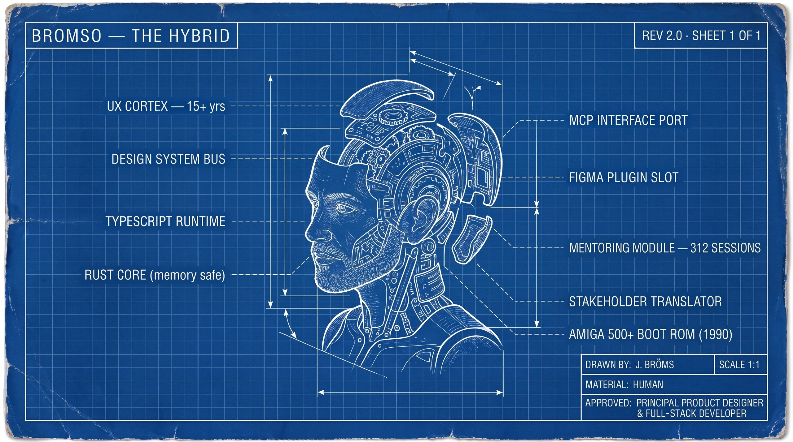

# **"Bromso"** · Senior Product Designer & Full-stack Developer

[](https://github.com/bromso/bromso/releases)
[](LICENSE)
[](#whats-included)
[](#whats-new-in-v2)
[](https://adplist.org/mentors/jonas)
[](https://app.uxcel.com/ux/jonasbroms)
[](https://www.figma.com/@jonasbroms)
[](https://github.com/bromso)

### I've been called **"The Hybrid"** and **"a unicorn"** in more than one recruitment process. Translation: I design the thing, build the thing, and then explain the thing to the people who pay for the thing, in whatever language each of them speaks.

### I like to think of myself as a creative and passionate person who aspires to innovate. Twenty-five years in, that is still true.

### Summary

Product designer and full-stack developer with 25+ years in digital production. Currently Senior UX Designer at Volvo Group, where I research and design the next generation of PLM/PDM tooling and help colleagues adopt AI-assisted ways of working. Founder of Odduse, the studio behind most of the projects below.

I spend my days in Figma and my evenings in Rust, TypeScript and Claude Code, building tools that make designers and developers understand each other faster: Figma plugins, MCP servers, agent skill frameworks and SaaS boilerplates.

On the side I mentor. Over 300 one-to-one sessions on ADPList, Super Mentor twelve months running, and one of the ADPList100 Most Influential Mentors of 2024.

| **Field**                                                                              | **Level / Role**  | **Years** |
| -------------------------------------------------------------------------------------- | ----------------- | --------- |
| [Product & UX design](https://en.wikipedia.org/wiki/User_experience_design)            | Senior / Lead     | 15+       |
| [Design systems](https://www.figma.com/@jonasbroms)                                    | Senior⋆⋆          | 10+       |
| [Graphic design](https://en.wikipedia.org/wiki/Graphic_design)                         | Senior⋆⋆          | 20+       |
| [Frontend (React, Next.js, TypeScript)](https://nextjs.org/)                           | Senior⋆⋆          | 6         |
| [Backend (Node.js, Bun)](https://bun.sh/)                                              | Medior⋆⋆          | 5         |
| [AI-assisted development (Claude Code, MCP, Copilot)](https://modelcontextprotocol.io/) | Senior            | 3         |
| [Rust](https://www.rust-lang.org/)                                                     | Medior, compiling | 2         |
| [Cloud (AWS, Vercel, Supabase)](https://aws.amazon.com/)                               | Medior⋆⋆          | 4         |
| [Mentoring & coaching](https://adplist.org/mentors/jonas)                              | Top 1% (ADPList)  | 3         |
| [Leadership & stakeholder management](https://www.linkedin.com/in/jonas-broms/)        | Director / Founder | 15+      |

⋆⋆ have a polytechnic education or a professional certificate in the field

---

## Table of contents

- [What's new in v2](#whats-new-in-v2)
- [Quickstart](#quickstart)
- [What's included](#whats-included)
- [Products & projects](#products--projects)
- [Open-source projects I've contributed to](#open-source-projects-ive-contributed-to)
- [Mentoring & recognition](#mentoring--recognition)
- [Track record](#track-record)
- [Tech stack](#tech-stack)
- [Testing](#testing)
- [Bugs & feature requests](#bugs--feature-requests)
- [Recommendations](#recommendations)
- [Contributing](#contributing)
- [Quotes](#quotes)
- [Creators](#creators)
- [Thanks to](#thanks-to)
- [Versioning & license](#versioning--license)

---

## What's new in v2

> Semantic versioning applies to humans too. This is a **major** release.

**Breaking changes**

- `React: Junior` has been removed. It was replaced by `Next.js: Senior` and nobody filed an issue.
- `Backend: 1 year` is deprecated. Use `Node.js | Bun | Rust` instead.
- `Creative Director` is no longer the default export. `Senior Product Designer` is.

**Features**

- Added Rust. Memory safety for the soul.
- Added AI-assisted development as a first-class workflow: Claude Code, MCP servers, agent skills, hooks and persistent memory.
- Added a mentoring module: 312 sessions, 18,000+ minutes, 108 reviews, four categories rated at 99%.
- Added 134 licences and certifications, including Google UX Design, IBM Full Stack Developer and Google Project Management.
- Added 59 Figma Community resources with 170,000+ combined uses.

**Fixes**

- "Over 10 000 downloads on Figma" was off by a factor of seventeen. Corrected.
- Table of contents now points to sections that exist.

---

## Quickstart

```typescript
import { Consultant } from "@bromso/core";

const jonas = new Consultant({
  name: "Jonas Bröms",
  born: 529545600000,
  based: ["Gothenburg, Sweden", "Paphos, Cyprus"],
  expertise: [
    "Product & UX design",
    "Design systems",
    "TypeScript",
    "React / Next.js",
    "Figma plugins",
    "AI-assisted development",
    "Mentoring",
    "Stakeholder management",
  ],
  learning: ["Rust", "Flutter", "Tauri"],
  moderate: ["3D design", "Photography", "Cinematography", "Copywriting"],
});

await jonas.install({ company: "yours", mode: "hybrid" });

for await (const problem of jonas.discover({ users: true, stakeholders: true })) {
  const solution = await jonas.design(problem);
  await jonas.build(solution, { with: ["Claude Code", "Bun", "Figma"] });
  await jonas.mentor(jonas.team);
}
```

### Peer dependencies

- A product problem that matters to real users
- A team that ships, and is willing to hear "have we talked to a user about this?"
- Trust that design and engineering are one craft with two tool chains
- Coffee. Non-negotiable.

### Install

On macOS:

```bash
open "mailto:jonasbroms@icloud.com?subject=Reconnect after I saw your GitHub profile"
```

On Linux:

```bash
xdg-open "mailto:jonasbroms@icloud.com?subject=Reconnect after I saw your GitHub profile"
```

On Windows:

```powershell
start "mailto:jonasbroms@icloud.com?subject=Reconnect after I saw your GitHub profile"
```

#### **In the email, please explain:**

- The problem you are solving and who it is for
- Expected hours per month and engagement model (employment, consulting, advisory)
- Compensation and benefits
- Management philosophy and work methodology
- Culture, training and development
- Tech stack, and how AI tooling fits into it

---

## What's included

```text
🧔 Bromso
│
├── ⭕ Private
│   ├┄┄ 🐣 1982.born
│   ├┄┄ 🤼 1989.start.wrestling
│   ├┄┄ 💾 1990.got.amiga500+
│   ├┄┄ ⌨️ 1991.start.demoing
│   ├┄┄ 🖥️ 1994.got.486intelmmx
│   ├┄┄ 🏀 1995.start.basketball
│   ├┄┄ 🌐 1995.first.lanparty
│   ├┄┄ 🇵🇭 2006.travel.philippines
│   ├┄┄ 🇭🇰 2006.travel.hongkong
│   ├┄┄ 🇺🇸 2009.travel.usa
│   ├┄┄ 🇫🇷 2012.travel.france
│   ├┄┄ 💒 2013.got.married
│   ├┄┄ 🇦🇪 2013.moved.unitedarabemirates
│   ├┄┄ 🇨🇾 2015.moved.cyprus
│   ├┄┄ 🐕 2019.founded.blunchers
│   └─┄ 🇸🇪 2026.working.gothenburg.hybrid
│
├── 🏫 School
│   ├┄┄ 🎓 1997.graduate.primaryschool
│   ├┄┄ 🎓 2001.graduate.highschool
│   ├┄┄ 🎓 2003.graduate.polytechnic.3dGraphics
│   ├┄┄ 🎓 2020.graduate.polytechnic.amazonAWS
│   ├┄┄ 🎓 2021.graduate.polytechnic.fullstackJS
│   ├┄┄ 📜 2023.certified.google.itSupport
│   ├┄┄ 📜 2023.certified.google.projectManagement
│   ├┄┄ 📜 2024.certified.google.uxDesign
│   ├┄┄ 📜 2024.certified.ibm.fullStackDeveloper
│   ├┄┄ 📜 2024.certified.google.digitalMarketing
│   ├┄┄ 📜 2025.certified.uxcel.productDesigner
│   └─┄ 📜 2026.certified.anthropic.claudeCode101
│
└── 💼 Career
    ├┄┄ 👨‍💻 1999.assistant.västfastigheterAb
    ├┄┄ 🪖 2001.specialist.swedishArmedForces
    ├┄┄ 👨‍💻 2003.technician.västfastigheterAb
    ├┄┄ 🎨 2004.designer.webcountryproductionAb
    ├┄┄ 🎥 2004.assistant.sverigestelevisionAb
    ├┄┄ 👔 2005.salesdirector.jonasolasspelAb
    ├┄┄ 🎨 2010.cofounder.creativedirector.ewebbyrånAb
    ├┄┄ 🛡️ 2013.securityofficer.gothiaProtectionGroup
    ├┄┄ 👔 2015.marketingdirector.syncrasyLtd
    ├┄┄ 🎨 2017.cofounder.cygroupDigitalLtd
    ├┄┄ 🎨 2017.founder.productdesigner.odduseLtd
    ├┄┄ 🎨 2021.frontenddeveloper.vinceAs
    ├┄┄ 🎨 2022.uxuileaddesigner.epulzeAb
    ├┄┄ 🎓 2023.mentor.adplist
    ├┄┄ 🎨 2023.productdesigner.groov
    ├┄┄ 🎨 2024.productlead.letterbeaver
    ├┄┄ 🎨 2024.productdesigner.eccovia
    └─┄ 🎨 2026.senioruxdesigner.volvoGroup
```

### Why would I be a good fit?

I'm a highly energised, social person who sees marketing, design, user experience and programming as one calling, not four departments.

### What can I contribute with?

Colleagues call me a hybrid. I have the knowledge and experience to talk with designers, marketers, programmers and executives in their own words, and the habit of turning those conversations into shipped software. My enthusiasm for tooling tends to rub off on the teams I join: at Volvo Group that currently means helping designers and stakeholders get productive with AI-assisted workflows.

### Why do I want to work with you?

Tech comes and goes. Three things have stayed: HTML, CSS and JavaScript on the front, people with problems on the other side of the screen, and the gap between design and engineering in the middle. I build in that gap. If your product is built on the web platform, with TypeScript or Rust underneath and a team that wants AI as a tool rather than a co-author, I would like to be part of that future.

---

## Products & projects

Things I have built, open to the public. Stars and status as of October 2026.

### Built by me

| Project | What it is | Stack |
| --- | --- | --- |
| [singularskills](https://github.com/bromso/singularskills) | 283 agent skills across 16 domains of digital production, with workflows, gates and a run log. Works with any agent that loads the Agent Skills format. | TypeScript, Claude Code |
| [singularrag](https://github.com/bromso/singularrag) | A repo map with retrieval provenance for coding agents. Tree-sitter into SQLite, personalised PageRank, token-budgeted maps served over MCP. | Rust, MCP, Bun |
| [singularmem](https://github.com/bromso/singularmem) | Local-first persistent memory layer for LLM workflows: hybrid search, provider adapters, an MCP server with 15 tools. | Rust, SQLite, TypeScript, Flutter |
| [bro (@bromso/figma-mcp)](https://github.com/bromso/bro) | MCP server that lets your AI design in Figma. "Bro" is Swedish for bridge. | TypeScript, MCP, Figma plugin |
| [figma-plugin-template](https://github.com/bromso/figma-plugin-template) | Figma/FigJam plugin boilerplate: React, Bun, TypeScript, Turborepo, shadcn/ui, Storybook 10. | TypeScript, Bun, Turborepo |
| [figma-design-skills](https://github.com/bromso/figma-design-skills) | Skills for the Figma agent: brief, plan, build, review. Makes it ask first and verify its own work. | Markdown, Figma |
| [figma-migrate-headless](https://github.com/bromso/figma-migrate-headless) | Figma plugin for migrating variant-heavy design systems to collections, variables, modes and slots. | TypeScript, Figma plugin |
| [discord-bot-template](https://github.com/bromso/discord-bot-template) | Production-grade Discord bot starter with a typed command framework, Postgres, a Next.js dashboard and Docker images. | Bun, Turborepo, discord.js, Drizzle |
| [seo](https://github.com/bromso/seo) | Multi-site SEO audit monorepo with an offline-first PWA dashboard and a Lighthouse-based runner. | Next.js, Supabase, Serwist |
| [homebrew-tap](https://github.com/bromso/homebrew-tap) | Homebrew formulae for my CLIs. | Ruby |

### In the lab

Private for now. Ask for a demo.

- **singularcode**: a fast terminal coding agent in Rust that runs on your own Claude Code install, with sandboxed file, search and shell tools behind one permission checkpoint.
- **virke**: a lightweight meta-prompting and spec-driven development framework for Claude Code, in Rust.
- **boilerplate-bun**: a Bun + Next.js 16 SaaS starter with subdomain microfrontends, an oRPC API, passkeys and 2FA, workspaces, Stripe billing, jobs, realtime and CI gates.
- **boilerplate-rust**: a Rust SaaS starter, hexagonal modular monolith on axum and Turso, with askama, htmx and Tailwind. No Node required.

### Figma Community

59 published resources with 170,000+ combined uses and almost 4,000 likes: icon libraries (tech, payment methods, social media, country flags), design-system and monorepo architecture templates, workshop canvases (SWOT, PESTEL, journey mapping, value vs. effort) and four plugins. [Browse them on Figma](https://www.figma.com/@jonasbroms).

### Communities

- **Slash**: a small Discord for designers and developers crossing into each other's craft, with AI as a tool, not a co-author.
- **Coders & Designers Paphos**: founder, meetups since 2023.
- **Blunchers**: founder, since 2019.
- **Frilansare Sverige**: contributor to the open-source site of Sweden's largest freelance community.

---

## Open-source projects I've contributed to

Frameworks and tools that millions of people use daily, where some of the code or assets are mine.

| <center><a href="https://v2.grommet.io/">Grommet</a></center>                                                                                           | <center><a href="https://storybook.js.org/">Storybook</a></center>                                                                                                  | <center><a href="https://strapi.io/">Strapi</a></center>                                                                                                | <center><a href="https://github.com/cyprusjs">CyprusJS</a></center>                                                                                 | <center><a href="https://semantic-release.gitbook.io/">Semantic-<br />Release</a></center>                                                                                      | <center><a href="https://github.com/commitizen/cz-cli">Commitizen</a></center>                                                                                                                                           | <center><a href="https://svgporn.com/">SVG Porn</a></center>                                                                                   |
| ------------------------------------------------------------------------------------------------------------------------------------------------------- | ------------------------------------------------------------------------------------------------------------------------------------------------------------------- | ------------------------------------------------------------------------------------------------------------------------------------------------------- | --------------------------------------------------------------------------------------------------------------------------------------------- | ------------------------------------------------------------------------------------------------------------------------------------------------------------------------------- | ------------------------------------------------------------------------------------------------------------------------------------------------------------------------------------------------------------------------ | ---------------------------------------------------------------------------------------------------------------------------------------------- |
| <center><a href="https://v2.grommet.io/"></a></center> | <center><a href="https://storybook.js.org/"></a></center> | <center><a href="https://strapi.io/"></a></center> | <center><a href="https://github.com/cyprusjs">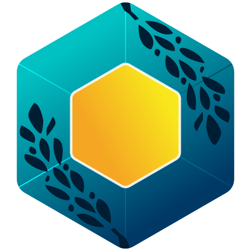</a></center> | <center><a href="https://semantic-release.gitbook.io/"></a></center> | <center><a href="https://github.com/commitizen/cz-cli"></a></center> | <center><a href="https://svgporn.com/"></a></center> |

Also: [Frilansare Sverige](https://github.com/frilansaresverige/frilansaresverige.se), the open-source site of Sweden's largest freelance community.

---

## Mentoring & recognition

| Where | What |
| --- | --- |
| [ADPList](https://adplist.org/mentors/jonas) | 312 sessions, 18,095 mentoring minutes, 108 reviews with 99% in Communication, Motivation, Problem Solving and Subject Knowledge. Super Mentor twelve consecutive months. Top 1% Mentor (2025). ADPList100 Most Influential Mentors of 2024. |
| [Uxcel](https://app.uxcel.com/ux/jonasbroms) | Verified Product Designer. Skill Graph 84/100, ranked #1 in Sweden and #36 globally. Named a 2024 Top Product Designer, #5 in specialty and #7 globally among 400,000+ designers. Two Editors' Choice badges. |
| [Developers Day](https://www.linkedin.com/in/jonas-broms/) | Nominated for Educator of the Year 2025 by Developers Bay. |
| [Credly](https://www.credly.com/users/jonas-broms) & [Coursera](https://www.coursera.org/) | 134 licences and certifications in total: Google UX Design, IBM Full Stack Developer, Google Project Management, Google IT Support, Google Digital Marketing & E-commerce, Claude Academy (MCP, Claude Code 101) and more. |
| Podcasts & talks | [UX Banter S5 E4: Building Resilience and Mentorship in UX Design](https://www.linkedin.com/in/jonas-broms/), Uxcel Portfolio Roast, design-to-development handover lectures. |

What mentees say:

> "Jonas is an exceptional mentor on ADPList. His sessions are structured, empathetic, and deeply insightful. He brings a unique blend of emotional intelligence and practical tools that help mentees reflect, set goals, and grow with clarity."
>
> — Deep Rastogi, Senior Technical Product Manager for AI and HealthTech, Roche

> "Jonas is really easy to talk to. His empathetic approach makes you feel heard, and he also has a ton of practical knowledge, which gives you insights that can be applied immediately."
>
> — Linnea Nilsson, Product Designer, Oneflow

---

## Track record

Some of the brands I've worked for over the years, as a consultant or employee.

These are some of the brands I've worked for during my years, either as a consultant or employee.

| <center><a href="https://www.volvocars.com/">Volvo</a></center>                                                                              | <center><a href="https://www.audi.com/">Audi</a></center>                                                                         | <center><a href="https://www.difc.ae/">DIFC</a></center>                                                                                                             | <center><a href="https://www.ica.se/">ICA</a></center>                                                               |
| -------------------------------------------------------------------------------------------------------------------------------------------- | --------------------------------------------------------------------------------------------------------------------------------- | -------------------------------------------------------------------------------------------------------------------------------------------------------------------- | -------------------------------------------------------------------------------------------------------------------- |
| <center><a href="https://www.volvocars.com/"></a></center> | <center><a href="https://www.audi.com/"></center> | <center><a href="https://www.difc.ae/"></a></center> | <center><a href="https://www.ica.se/">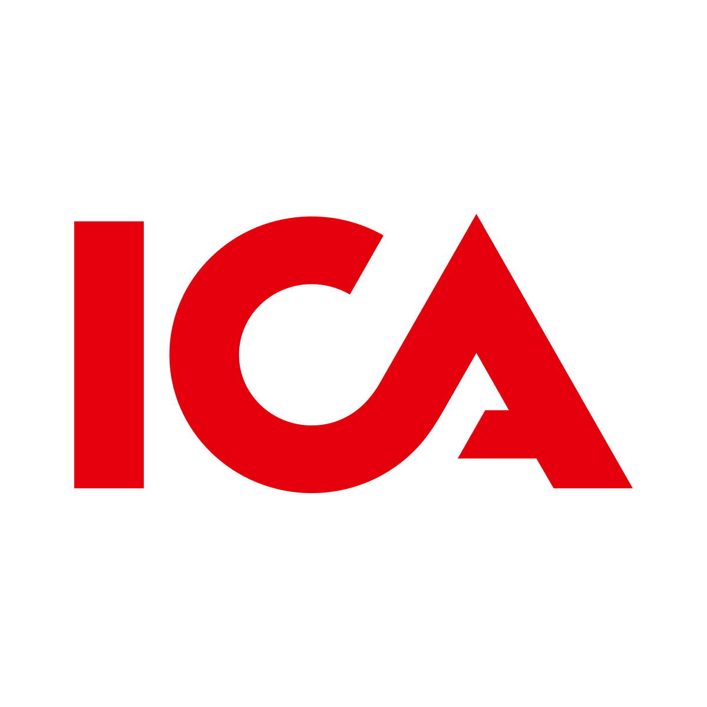 |

| <center><a href="https://www.qmatic.com/">Qmatic</a></center>                                                                               | <center><a href="https://www.preem.se/">Preem</a></center>                                                                              | <center><a href="https://www.hardrock.com/">Hard Rock</a></center>                                                                                       | <center><a href="https://www.cat.com/">Caterpillar</a></center>                                                                                    |
| ------------------------------------------------------------------------------------------------------------------------------------------- | --------------------------------------------------------------------------------------------------------------------------------------- | -------------------------------------------------------------------------------------------------------------------------------------------------------- | -------------------------------------------------------------------------------------------------------------------------------------------------- |
| <center><a href="https://www.qmatic.com/">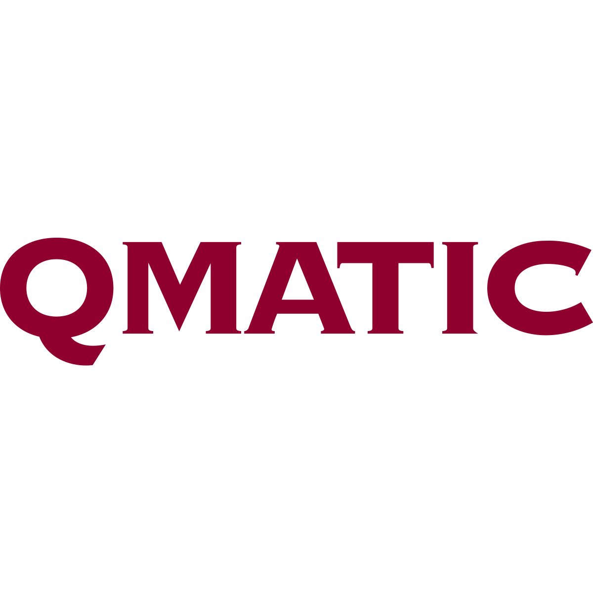</a></center> | <center><a href="https://www.preem.se/">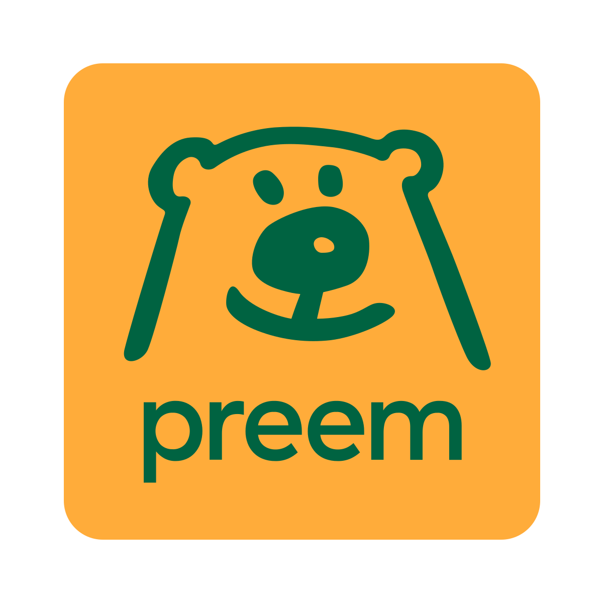</a></center> | <center><a href="https://www.hardrock.com/">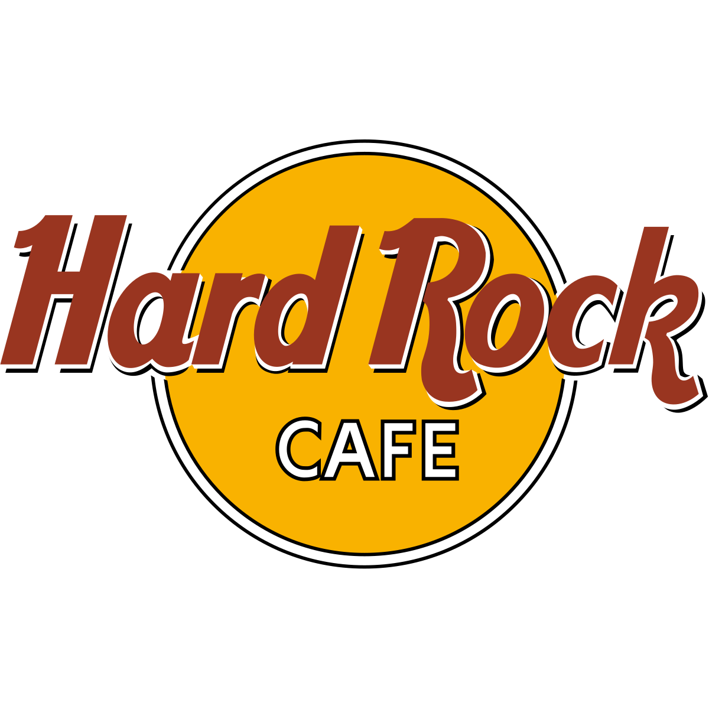</a></center> | <center><a href="https://www.cat.com/">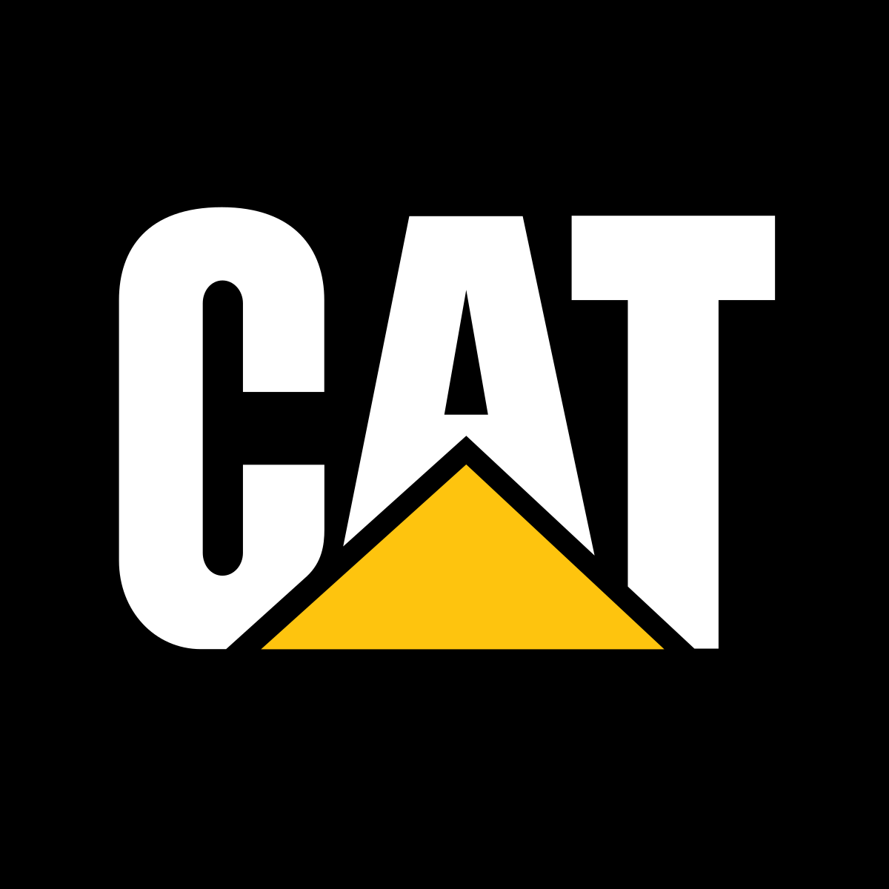</a></center> |

More recent work, without the logos: **Volvo Group** (PLM/PDM tooling, 2026), **Eccovia** (building automation, headless design system), **LetterBeaver** (AI-driven wallet app), **Groov** (fintech PaaS), **Epulze** (esports; 1467% turnover growth that validated €10M in funding, and the site for the DOTA Pro Circuit world championship), plus NA-KD, Ellos, Cryptzone and Forever Living from the agency years.

---

## Tech stack

Technology I love and use. "Daily driver" is what is open on my machine right now. "Skill progression" is a self-assessment, not a benchmark, and Rust is still compiling.

### Languages

| Avatar | Name | Category | Daily driver | Skill progression |
| :---: | --- | --- | :---: | --- |
|  | [TypeScript](https://www.typescriptlang.org/) | Language | ✅ | `▓▓▓▓▓▓▓▓▓▓▓▓▓▓▓▓▓░░░ 85%` |
|  | [JavaScript](https://developer.mozilla.org/en-US/docs/Web/JavaScript) | Language | ✅ | `▓▓▓▓▓▓▓▓▓▓▓▓▓▓▓▓▓▓░░ 90%` |
|  | [Rust](https://www.rust-lang.org/) | Language | ✅ | `▓▓▓▓▓▓▓▓▓▓▓░░░░░░░░░ 55%` |
|  | [Python](https://www.python.org/) | Language |  | `▓▓▓▓▓▓▓▓▓░░░░░░░░░░░ 45%` |
|  | [Dart](https://dart.dev/) | Language |  | `▓▓▓▓▓▓▓░░░░░░░░░░░░░ 35%` |
|  | [Markdown](https://commonmark.org/) | Language | ✅ | `▓▓▓▓▓▓▓▓▓▓▓▓▓▓▓▓▓▓▓░ 95%` |

### Runtimes & package managers

| Avatar | Name | Category | Daily driver | Skill progression |
| :---: | --- | --- | :---: | --- |
|  | [Bun](https://bun.sh/) | Runtime | ✅ | `▓▓▓▓▓▓▓▓▓▓▓▓▓▓▓▓░░░░ 80%` |
|  | [Node.js](https://nodejs.org/) | Runtime | ✅ | `▓▓▓▓▓▓▓▓▓▓▓▓▓▓▓▓░░░░ 80%` |
|  | [Deno](https://deno.com/) | Runtime |  | `▓▓▓▓▓▓░░░░░░░░░░░░░░ 30%` |
|  | [pnpm](https://pnpm.io/) | Package manager |  | `▓▓▓▓▓▓▓▓▓▓▓▓▓▓░░░░░░ 70%` |
|  | [npm](https://www.npmjs.com/) | Package manager | ✅ | `▓▓▓▓▓▓▓▓▓▓▓▓▓▓▓▓▓░░░ 85%` |
|  | [Homebrew](https://brew.sh/) | Package manager | ✅ | `▓▓▓▓▓▓▓▓▓▓▓▓▓▓▓░░░░░ 75%` |

### Frontend

| Avatar | Name | Category | Daily driver | Skill progression |
| :---: | --- | --- | :---: | --- |
|  | [React](https://react.dev/) | UI library | ✅ | `▓▓▓▓▓▓▓▓▓▓▓▓▓▓▓▓▓░░░ 85%` |
|  | [Next.js](https://nextjs.org/) | Framework | ✅ | `▓▓▓▓▓▓▓▓▓▓▓▓▓▓▓▓▓░░░ 85%` |
|  | [Tailwind CSS](https://tailwindcss.com/) | Styling | ✅ | `▓▓▓▓▓▓▓▓▓▓▓▓▓▓▓▓▓░░░ 85%` |
|  | [shadcn/ui](https://ui.shadcn.com/) | Component library | ✅ | `▓▓▓▓▓▓▓▓▓▓▓▓▓▓▓▓░░░░ 80%` |
|  | [Storybook](https://storybook.js.org/) | UI documentation | ✅ | `▓▓▓▓▓▓▓▓▓▓▓▓▓▓▓▓▓░░░ 85%` |
|  | [Vite](https://vite.dev/) | Build tool |  | `▓▓▓▓▓▓▓▓▓▓▓▓▓▓░░░░░░ 70%` |
|  | [Turborepo](https://turborepo.com/) | Monorepo | ✅ | `▓▓▓▓▓▓▓▓▓▓▓▓▓▓▓▓░░░░ 80%` |
|  | [Motion](https://motion.dev/) | Animation |  | `▓▓▓▓▓▓▓▓▓▓▓▓░░░░░░░░ 60%` |
|  | [React Router / Remix](https://reactrouter.com/) | Framework |  | `▓▓▓▓▓▓▓▓▓▓░░░░░░░░░░ 50%` |
|  | [Astro](https://astro.build/) | Framework |  | `▓▓▓▓▓▓▓▓▓░░░░░░░░░░░ 45%` |
|  | [MUI](https://mui.com/) | Component library |  | `▓▓▓▓▓▓▓▓▓▓▓▓▓░░░░░░░ 65%` |
|  | [Tauri](https://tauri.app/) | Desktop apps |  | `▓▓▓▓▓▓▓▓▓▓░░░░░░░░░░ 50%` |
|  | [Flutter](https://flutter.dev/) | Mobile apps |  | `▓▓▓▓▓▓▓░░░░░░░░░░░░░ 35%` |
|  | [WebAssembly](https://webassembly.org/) | Runtime |  | `▓▓▓▓▓▓░░░░░░░░░░░░░░ 30%` |

### Backend & data

| Avatar | Name | Category | Daily driver | Skill progression |
| :---: | --- | --- | :---: | --- |
|  | [Hono](https://hono.dev/) | Web framework |  | `▓▓▓▓▓▓▓▓▓▓▓▓░░░░░░░░ 60%` |
|  | [axum](https://github.com/tokio-rs/axum) | Web framework (Rust) |  | `▓▓▓▓▓▓▓▓▓▓░░░░░░░░░░ 50%` |
|  | [oRPC](https://orpc.unnoq.com/) | Typed APIs |  | `▓▓▓▓▓▓▓▓▓▓▓▓░░░░░░░░ 60%` |
|  | [GraphQL](https://graphql.org/) | API |  | `▓▓▓▓▓▓▓▓▓▓▓▓▓░░░░░░░ 65%` |
|  | [Zod](https://zod.dev/) | Validation | ✅ | `▓▓▓▓▓▓▓▓▓▓▓▓▓▓▓░░░░░ 75%` |
|  | [Drizzle ORM](https://orm.drizzle.team/) | ORM | ✅ | `▓▓▓▓▓▓▓▓▓▓▓▓▓░░░░░░░ 65%` |
|  | [Prisma](https://www.prisma.io/) | ORM |  | `▓▓▓▓▓▓▓▓▓▓▓▓░░░░░░░░ 60%` |
|  | [PostgreSQL](https://www.postgresql.org/) | Database | ✅ | `▓▓▓▓▓▓▓▓▓▓▓▓▓░░░░░░░ 65%` |
|  | [SQLite / Turso](https://turso.tech/) | Database | ✅ | `▓▓▓▓▓▓▓▓▓▓▓▓▓░░░░░░░ 65%` |
|  | [Redis](https://redis.io/) | Cache |  | `▓▓▓▓▓▓▓▓▓░░░░░░░░░░░ 45%` |
|  | [Supabase](https://supabase.com/) | Backend platform |  | `▓▓▓▓▓▓▓▓▓▓▓▓▓▓░░░░░░ 70%` |
|  | [Sanity](https://www.sanity.io/) | CMS |  | `▓▓▓▓▓▓▓▓▓▓▓▓░░░░░░░░ 60%` |
|  | [Strapi](https://strapi.io/) | CMS |  | `▓▓▓▓▓▓▓▓▓▓▓▓▓▓░░░░░░ 70%` |
|  | [Stripe](https://stripe.com/) | Payments |  | `▓▓▓▓▓▓▓▓▓▓▓░░░░░░░░░ 55%` |

### AI & agents

| Avatar | Name | Category | Daily driver | Skill progression |
| :---: | --- | --- | :---: | --- |
|  | [Claude Code](https://claude.com/claude-code) | Coding agent | ✅ | `▓▓▓▓▓▓▓▓▓▓▓▓▓▓▓▓▓▓░░ 90%` |
|  | [Model Context Protocol](https://modelcontextprotocol.io/) | Agent tooling | ✅ | `▓▓▓▓▓▓▓▓▓▓▓▓▓▓▓▓░░░░ 80%` |
|  | [GitHub Copilot](https://github.com/features/copilot) | Coding agent | ✅ | `▓▓▓▓▓▓▓▓▓▓▓▓▓▓▓░░░░░ 75%` |
|  | [OpenAI Codex](https://openai.com/codex/) | Coding agent |  | `▓▓▓▓▓▓▓▓▓▓▓▓▓░░░░░░░ 65%` |
|  | [Cursor](https://cursor.com/) | AI editor |  | `▓▓▓▓▓▓▓▓▓▓▓▓░░░░░░░░ 60%` |
|  | [OpenAI API](https://platform.openai.com/) | LLM API |  | `▓▓▓▓▓▓▓▓▓▓▓▓▓░░░░░░░ 65%` |

### Design

| Avatar | Name | Category | Daily driver | Skill progression |
| :---: | --- | --- | :---: | --- |
|  | [Figma](https://www.figma.com/) | Product design | ✅ | `▓▓▓▓▓▓▓▓▓▓▓▓▓▓▓▓▓▓▓░ 95%` |
|  | [FigJam](https://www.figma.com/figjam/) | Workshops & diagrams | ✅ | `▓▓▓▓▓▓▓▓▓▓▓▓▓▓▓▓▓▓░░ 90%` |
|  | [Sketch](https://www.sketch.com/) | Product design |  | `▓▓▓▓▓▓▓▓▓▓▓▓▓▓░░░░░░ 70%` |
|  | [Framer](https://www.framer.com/) | Prototyping & sites |  | `▓▓▓▓▓▓▓▓▓▓▓░░░░░░░░░ 55%` |
| 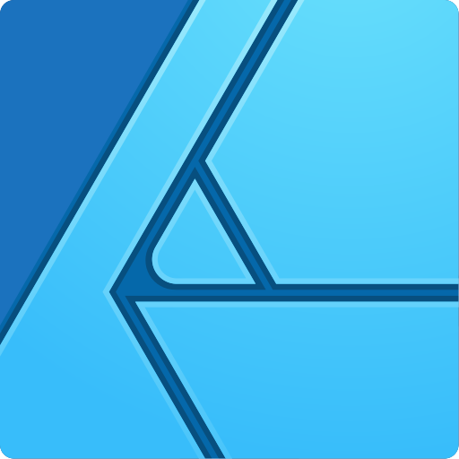 | [Affinity Designer](https://affinity.serif.com/) | Vector graphics |  | `▓▓▓▓▓▓▓▓▓▓▓▓▓▓▓▓░░░░ 80%` |
| 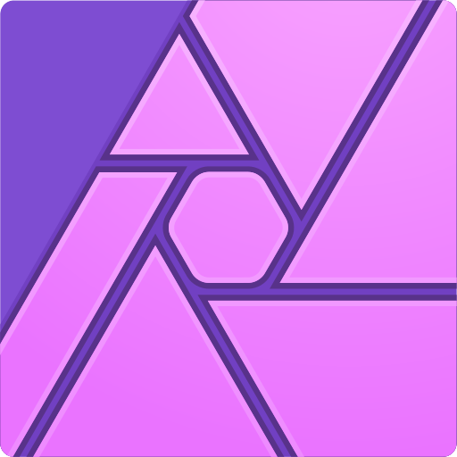 | [Affinity Photo](https://affinity.serif.com/) | Photo editing |  | `▓▓▓▓▓▓▓▓▓▓▓▓▓▓▓░░░░░ 75%` |
| 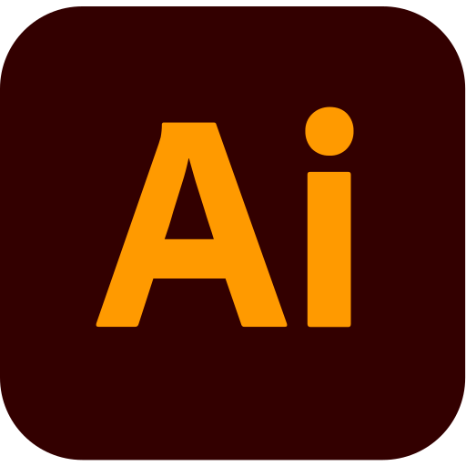 | [Illustrator](https://www.adobe.com/products/illustrator.html) | Vector graphics |  | `▓▓▓▓▓▓▓▓▓▓▓▓▓▓▓▓░░░░ 80%` |
| 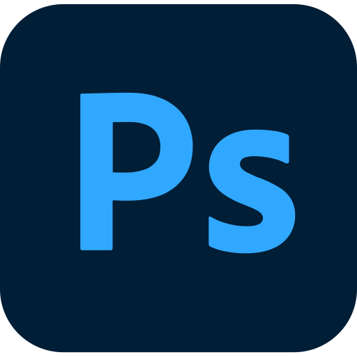 | [Photoshop](https://www.adobe.com/products/photoshop.html) | Photo editing |  | `▓▓▓▓▓▓▓▓▓▓▓▓▓▓▓▓░░░░ 80%` |
|  | [Final Cut Pro](https://www.apple.com/final-cut-pro/) | Video editing |  | `▓▓▓▓▓▓▓▓▓▓▓▓░░░░░░░░ 60%` |
| 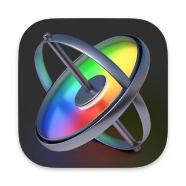 | [Motion (Apple)](https://www.apple.com/final-cut-pro/motion/) | Visual effects |  | `▓▓▓▓▓▓▓▓▓▓░░░░░░░░░░ 50%` |

### DevOps & workflow

| Avatar | Name | Category | Daily driver | Skill progression |
| :---: | --- | --- | :---: | --- |
|  | [GitHub](https://github.com/) | Code hosting | ✅ | `▓▓▓▓▓▓▓▓▓▓▓▓▓▓▓▓▓▓░░ 90%` |
|  | [GitHub Actions](https://github.com/features/actions) | CI/CD | ✅ | `▓▓▓▓▓▓▓▓▓▓▓▓▓▓▓▓░░░░ 80%` |
|  | [Git](https://git-scm.com/) | Version control | ✅ | `▓▓▓▓▓▓▓▓▓▓▓▓▓▓▓▓▓░░░ 85%` |
|  | [Docker](https://www.docker.com/) | Containers | ✅ | `▓▓▓▓▓▓▓▓▓▓▓▓▓▓░░░░░░ 70%` |
|  | [Kubernetes](https://kubernetes.io/) | Orchestration |  | `▓▓▓▓▓▓▓▓▓░░░░░░░░░░░ 45%` |
|  | [Playwright](https://playwright.dev/) | E2E testing |  | `▓▓▓▓▓▓▓▓▓▓▓▓▓░░░░░░░ 65%` |
|  | [Vercel](https://vercel.com/) | Hosting | ✅ | `▓▓▓▓▓▓▓▓▓▓▓▓▓▓░░░░░░ 70%` |
|  | [Cloudflare](https://www.cloudflare.com/) | Edge & DNS |  | `▓▓▓▓▓▓▓▓▓▓▓░░░░░░░░░ 55%` |
|  | [Netlify](https://www.netlify.com/) | Hosting |  | `▓▓▓▓▓▓▓▓▓▓▓▓░░░░░░░░ 60%` |
|  | [semantic-release](https://semantic-release.gitbook.io/) | Versioning | ✅ | `▓▓▓▓▓▓▓▓▓▓▓▓▓▓▓▓▓░░░ 85%` |
| 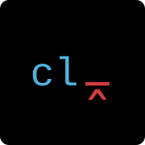 | [commitlint](https://commitlint.js.org/) | Commit convention | ✅ | `▓▓▓▓▓▓▓▓▓▓▓▓▓▓▓▓░░░░ 80%` |
| 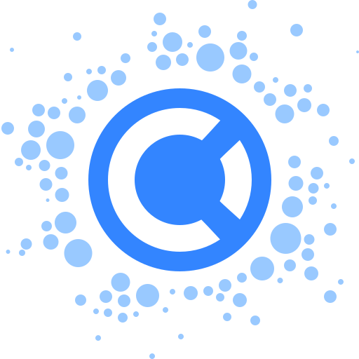 | [Commitizen](https://commitizen.github.io/cz-cli/) | Commit convention | ✅ | `▓▓▓▓▓▓▓▓▓▓▓▓▓▓▓▓░░░░ 80%` |
|  | [Husky](https://typicode.github.io/husky/) | Git hooks |  | `▓▓▓▓▓▓▓▓▓▓▓▓▓▓▓░░░░░ 75%` |
|  | [ESLint](https://eslint.org/) | Lint | ✅ | `▓▓▓▓▓▓▓▓▓▓▓▓▓▓▓░░░░░ 75%` |
|  | [Prettier](https://prettier.io/) | Formatting | ✅ | `▓▓▓▓▓▓▓▓▓▓▓▓▓▓▓▓░░░░ 80%` |
|  | [EditorConfig](https://editorconfig.org/) | Formatting | ✅ | `▓▓▓▓▓▓▓▓▓▓▓▓▓▓▓▓░░░░ 80%` |

### Workstation

| Avatar | Name | Category | Daily driver | Skill progression |
| :---: | --- | --- | :---: | --- |
|  | [MacBook Pro](https://www.apple.com/macbook-pro/) | Hardware | ✅ | `▓▓▓▓▓▓▓▓░░░░░░░░░░░░ 40%` |
|  | [macOS](https://www.apple.com/macos/) | Operating system | ✅ | `▓▓▓▓▓▓▓▓▓▓▓▓▓▓▓▓▓░░░ 85%` |
|  | [Linux](https://kernel.org/) | Operating system |  | `▓▓▓▓▓▓▓▓▓▓▓▓░░░░░░░░ 60%` |
|  | [Zsh + Oh My Zsh](https://ohmyz.sh/) | Shell | ✅ | `▓▓▓▓▓▓▓▓▓▓▓▓▓░░░░░░░ 65%` |
|  | [VS Code](https://code.visualstudio.com/) | Editor | ✅ | `▓▓▓▓▓▓▓▓▓▓▓▓▓▓▓▓▓░░░ 85%` |
|  | [Notion](https://www.notion.com/) | Docs & planning |  | `▓▓▓▓▓▓▓▓▓▓▓▓▓▓░░░░░░ 70%` |
|  | [Jira](https://www.atlassian.com/software/jira) | Planning |  | `▓▓▓▓▓▓▓▓▓▓▓▓▓▓░░░░░░ 70%` |

---

## Testing

I'm not a big fan of personality or logic tests in a recruitment process. The research I've read suggests they have their place in personal development, measured over a long period, not in a one-off hiring funnel.

So here is the olive branch: my results from [Alva Labs](https://www.alvalabs.io/) are below, and I'll share the full reports on request. I will ask what the result is being compared against and why.

| **Field**   | **Result**                                       | **Vendor**                           |
| ----------- | ------------------------------------------------ | ------------------------------------ |
| Logic       | `▓▓▓▓▓▓▓▓▓▓▓▓▓▓▓▓▓▓▓░ 98%, (10/10)`              | [Alva Labs](https://www.alvalabs.io/) |
| Personality | Openness to Experience 10/10. [Ask for the rest](mailto:jonasbroms@icloud.com) | [Alva Labs](https://www.alvalabs.io/) |

---

## Bugs & feature requests

### Known bugs

- [ ] Impostor syndrome in certain situations
- [ ] Highly opinionated
- [ ] Occasional toxic perfectionism, which pushes deadlines
- [ ] Starts a new side project before the previous one has a README

### Feature requests

- [ ] Meditate more often and longer
- [ ] Be kinder to myself
- [ ] Exercise more
- [ ] Ship singularcode

Found a bug not listed here? [Open an issue](https://github.com/bromso/bromso/issues/new/choose). Security-related bugs go through [SECURITY.md](SECURITY.md).

---

## Recommendations

| Avatar                                                                                     | Name & Title                                                                                                                                                      | Testimonial                                                                                                                                                                                                                                                                                                                                                                                                                                                                                                                                                                                                                                                                                                      |
| ------------------------------------------------------------------------------------------ | ----------------------------------------------------------------------------------------------------------------------------------------------------------------- | ---------------------------------------------------------------------------------------------------------------------------------------------------------------------------------------------------------------------------------------------------------------------------------------------------------------------------------------------------------------------------------------------------------------------------------------------------------------------------------------------------------------------------------------------------------------------------------------------------------------------------------------------------------------------------------------------------------------- |
|  | **Björn "Natthiko" Lindeblad** <br /> <h6>Podcaster, Public Speaker, Buddhist monk, Fellow human being<br />Jag kan ha fel</h6><br /> | _"Of all those who have helped me along the way digitally, Jonas Bröms is one of the most generous, competent and creative. Now he has made a website that makes it easy to find my stuff for a long, long time into the future. It's of course called jagkanhafel.com. Hat off to you, Jonas, thank you very much!"_                                                                                                                                                                                                                                                                                                                                                                                  |
|                 | **Stefan Jakobsson** <br /> <h6>Account Director,<br />[Dear friends](https://dearfriends.se/)</h6>                                                               | _"We have used Jonas and his company eWebbyrån on several occasions and are very pleased with the work and their ability to adapt to any kind of web related project. I can truly recommend Jonas and we will continue using their services in the future."_                                                                                                                                                                                                                                                                                                                                                                                                                                                     |
|                         | **Fredrik Thor** <br /> <h6>CEO,<br />[PR Offset](https://pr-offset.se/)</h6>                                                                                     | _"Jonas is a true entrepreneur with high creative skills.I strongly recommend Jonas both as a consult in IT related issues and in web application construction.As a person he is calm, trustworthy and he always has a positive attitude towards people he meet."_                                                                                                                                                                                                                                                                                                                                                                                                                                               |
|                               | **Ola Eklöf** <br /> <h6>CEO,<br />Jonas & Olasspel</h6>                                                                                                          | _"Jonas has become a close friend who I first got to know more than 20 years ago when I started to train him in Greco-romain style wrestling. I have only seen Jonas excel and impress in his choices and progress during the years. 2005 I lost one important employee with big shoes to fill. I knew that Jonas wanted something more at the time beeing out of his career, so I hired him. He is very dedicated in his work and always tries to deliver more then you expect. He is always hungry for more, ambitionous with a creative way on solving problems. I tried him out for a year before I promoted him to Sales Director. And it was an easy choice. I have only good things to say about Jonas."_ |
|                                                                                            | **Dr. Zsolt Szilagyi** <br /> <h6>IT operations & management consultant</h6>                                                                                      | _"Working with Jonas is always eye-opening. He truly delivers on the title of Chief User Experience Strategist, creating strategies and solutions with a 360°-view of customer, brand, product, market, and culture. He is the kind of guy you want on your payroll when success is not optional."_ |
|                                                                                            | **Gustavo Ferreira** <br /> <h6>Full-Stack Engineer, Founder of Gustek</h6>                                                                                        | _"I had the pleasure of working with Jonas for a few months on a large project. In that short time, he impressed me with his technical skills, professionalism, and collaborative attitude. He was always willing to help and shared his knowledge openly, making a real impact on the team."_ |

More on [LinkedIn](https://www.linkedin.com/in/jonas-broms/details/recommendations/).

---

## Contributing

If you want to contribute to me, my life or my learning, connect on any of these and let's book a video call or meet in real life:

| <center>[Website](https://www.jonasbroms.com/)</center>                                                                                           | <center>[Github](https://github.com/bromso)</center>                                                                                          | <center>[Figma](https://www.figma.com/@jonasbroms)</center>                                                                                                    | <center>[Facebook](https://www.facebook.com/jonas.broms)</center>                                                                                            | <center>[Instagram](https://www.instagram.com/jonasbroms/)</center>                                                                                             | <center>[LinkedIn](https://www.linkedin.com/in/jonas-broms/)</center>                                                                                            | <center>[Twitter](https://twitter.com/jonasbroms)</center>                                                                                           | <center>[Email](mailto:jonasbroms@icloud.com)</center>                                                                                           |
| ------------------------------------------------------------------------------------------------------------------------------------------------- | --------------------------------------------------------------------------------------------------------------------------------------------- | -------------------------------------------------------------------------------------------------------------------------------------------------------------- | ------------------------------------------------------------------------------------------------------------------------------------------------------------ | --------------------------------------------------------------------------------------------------------------------------------------------------------------- | ---------------------------------------------------------------------------------------------------------------------------------------------------------------- | ---------------------------------------------------------------------------------------------------------------------------------------------------- | ------------------------------------------------------------------------------------------------------------------------------------------------ |
| <center><a href="https://www.jonasbroms.com/"></a></center> | <center><a href="https://github.com/bromso">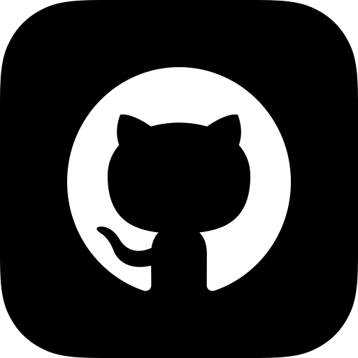</a></center> | <center><a href="https://www.figma.com/@jonasbroms"></a></center> | <center><a href="https://www.facebook.com/jonas.broms"></a></center> | <center><a href="https://www.instagram.com/jonasbroms/"></a></center> | <center><a href="https://www.linkedin.com/in/jonas-broms/"></a></center> | <center><a href="https://twitter.com/jonasbroms"></a></center> | <center><a href="https://twitter.com/jonasbroms"></a></center> |

Also on [ADPList](https://adplist.org/mentors/jonas), [Uxcel](https://app.uxcel.com/ux/jonasbroms) and [Credly](https://www.credly.com/users/jonas-broms). Contributions to this repository follow [CONTRIBUTING.md](CONTRIBUTING.md) and the [Code of Conduct](CODE_OF_CONDUCT.md).

---

## Quotes

> ##### _**"The meaning of life is to find your gift.**_
>
> ##### _**The purpose of life is to give it away"**_
>
> ---
>
> ###### Unknown

---

> ##### _**"On my business card, I am a Creative Director.**_
>
> ##### _**In my mind, I am a designer.**_
>
> ##### _**But in my heart, I am a gamer"**_
>
> ---
>
> ###### _Satoru Iwata, former CEO of Nintendo_

---

> ##### _**"Si vis pacem, para bellum"**_
>
> ##### _**"If you want peace, prepare for war"**_
>
> ---
>
> ###### _Publius Flavius Vegetius Renatus_

---

> ##### _**"Don't believe everything you think"**_
>
> ---
>
> ###### Björn "Natthiko" Lindeblad

---

## Creators

| Avatar                                            | Name   | Role   |
| ------------------------------------------------- | ------ | ------ |
|  | Ingrid | Mother |
|   | Tommy  | Father |

## Thanks to

| Avatar                                                | Name     | Role      |
| ----------------------------------------------------- | -------- | --------- |
|          | Olle     | Brother   |
|        | Brian    | My dog #1 |
|    | Freddie  | My dog #2 |

---

## Versioning & license

This repository is released with [semantic-release](https://semantic-release.gitbook.io/) and follows [Conventional Commits](https://www.conventionalcommits.org/). Every merge to `master` that changes me in a meaningful way bumps the version in [CHANGELOG.md](CHANGELOG.md).

Code and text in this repository are licensed under the [MIT License](LICENSE). Brand logos belong to their respective owners. The person described is not covered by the license and remains closed-source in all the ways that matter.
